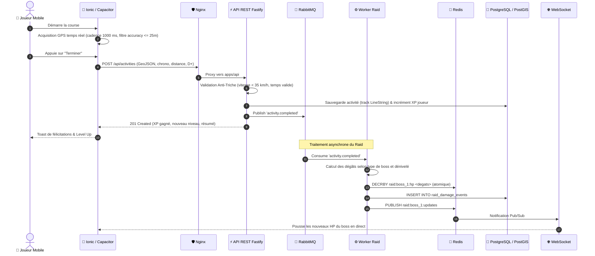

# 📐 Architecture Système & Réseau — Stride Quest

Ce document détaille l'architecture logicielle, la topologie réseau, les flux de données et les choix d'ingénierie du projet **Stride Quest**.

---

## 1. Topologie Réseau : Modèle 2 Machines Virtuelles (VM)

Pour garantir la sécurité des données sportives, isoler la base de données et encaisser la charge des événements de raid en direct, l'infrastructure est découpée en **deux machines virtuelles distinctes** :

```text
               ┌───────────────────────────────┐
               │  Stride Quest (Client Mobile) │
               └──────────────┬────────────────┘
                              │
               ┌──────────────┴──────────────┐
               │ HTTPS (REST)     WSS (Live) │
               ▼                             ▼
┌─────────────────────────────────────────────────────────────┐
│  VM 1 : Applicative (Seule machine exposée sur Internet)    │
│                                                             │
│   ┌─────────────────────────────────────────────────────┐   │
│   │              Nginx (Reverse Proxy & TLS)            │   │
│   │     - Terminaison TLS / Certificats HTTPS/WSS       │   │
│   │     - Rate Limiting (anti DDoS & brute force)       │   │
│   │     - Routage dynamique selon chemin d'URL          │   │
│   └───────────────┬─────────────────────────────┬───────┘   │
│          /api/*   │                     /ws/*   │           │
│                   ▼                             ▼           │
│   ┌───────────────────────────────┐   ┌─────────────────┐   │
│   │  API REST (Fastify 5)         │   │ Service         │   │
│   │  - Auth JWT, profils, quêtes  │   │ WebSocket       │   │
│   │  - Ingestion des activités    │   │ - Stream des PV │   │
│   │  - Filtre Anti-Triche synchr. │   │   du boss live  │   │
│   └───────────────┬───────────────┘   └────────┬────────┘   │
│                   │ Publish                    │            │
│                   ▼                            │            │
│         [ RabbitMQ (Broker AMQP) ]             │            │
│                   │ Consume                    │            │
│                   ▼                            │            │
│   ┌───────────────────────────────┐            │            │
│   │  Workers de Raid              │            │            │
│   │  - Calcul des dégâts boss     │            │            │
│   │  - Conversion distance/effort │            │            │
│   └───────────────┬───────────────┘            │            │
└───────────────────┼────────────────────────────┼────────────┘
                    │                            │
════════════════════╪════════════════════════════╪═════════════
                    │ Réseau Privé (VLAN / VPN)  │ Réseau Privé
┌───────────────────┼────────────────────────────┼────────────┐
│  VM 2 : Données   ▼                            ▼            │
│   ┌───────────────────────────────┐   ┌─────────────────┐   │
│   │  PostgreSQL 16 / PostGIS 3.4  │   │  Redis 7        │   │
│   │  - Tables: players, activities│   │  - Décompte HP  │   │
│   │    raids, raid_damage_events  │   │    atomique     │   │
│   │  - Index spatiaux GiST (4326) │   │  - Pub/Sub WSS  │   │
│   └───────────────────────────────┘   └─────────────────┘   │
│                                                             │
│   * Accès interdit depuis l'extérieur — écoute privée       │
└─────────────────────────────────────────────────────────────┘
```

---

## 2. Rôle des Composants

### A. VM 1 — Applicative
1. **Nginx** :
   - Point d'entrée unique de la plateforme (`port 443`).
   - Reverse proxy répartissant le trafic : les requêtes HTTP/JSON vers Fastify et les connexions bidirectionnelles vers le service WebSocket.
   - Protection contre le spam de positions (Rate limiting : 1 ping / 3-5 secondes max par client).
2. **API REST (`apps/api`)** :
   - Développée en **Fastify 5** et TypeScript.
   - Gère l'authentification (tokens Bearer JWT), la gestion de profil et la validation de fin de parcours.
   - Exécute le moteur **Anti-Triche synchrone** : si une sortie est suspecte (vitesse impossible), elle est rejetée immédiatement avant toute écriture.
   - Émet les activités validées sur le bus RabbitMQ.
3. **RabbitMQ (Message Broker)** :
   - Découple la réception des courses et le calcul lourd des dégâts de raid.
   - Garantit qu'aucun pic de charge (ex. fin de course groupée de 500 coureurs) ne sature le serveur HTTP.
4. **Workers de Raid (`apps/workers`)** :
   - Consomment la file `activity.completed` en tâche de fond.
   - Calculent l'impact de l'activité sur le boss de raid géolocalisé (multiplicateurs de dénivelé, météo, type de boss).
   - Mettent à jour la vie du boss dans Redis et enregistrent l'événement d'historique dans PostgreSQL.
5. **Service WebSocket (`apps/ws`)** :
   - Maintient des connexions persistantes avec les smartphones affichant l'onglet *Défis / Raid*.
   - Écoute les modifications de points de vie via le Pub/Sub de Redis pour pousser l'animation de dégâts au client en temps réel sans polling HTTP.

### B. VM 2 — Données (Privée)
1. **PostgreSQL 16 & PostGIS 3.4** :
   - Source de vérité durable et relationnelle.
   - Modélisation géométrique `GEOMETRY(LineString, 4326)` pour stocker l'intégralité du chemin GPS parcouru.
   - Index GiST spatiaux (`CREATE INDEX ... USING GIST(track);`) pour les recherches de proximité (`ST_DWithin`) et les croisements géographiques.
2. **Redis 7** :
   - Cache ultra-rapide en mémoire pour les données temps réel à forte contention.
   - Stocke l'état instantané du boss (`raid:<id>:hp`) et le canal de notification Pub/Sub.

---

## 3. Cycle de Vie Complet d'une Course

Voici la séquence chronologique d'un entraînement, du premier fix GPS jusqu'à l'impact sur le boss :



---

## 4. Règles d'Ingénierie & Sécurité

### A. Modèle Anti-Triche (Anti-Spoofing GPS)
Les données du client ne sont jamais considérées comme intègres par défaut :
1. **Plafond de vitesse moyenne** :
   - Marche / Course : $\le 35\text{ km/h}$ ($9.72\text{ m/s}$).
   - Cyclisme : $\le 90\text{ km/h}$ ($25\text{ m/s}$).
2. **Contrôle de chronologie** :
   - `endedAt >= startedAt` obligatoire.
   - Si `distance > 0`, `durationSeconds > 0` obligatoire.
3. **Contrôle de cohérence spatiale** :
   - Vérification de la distance déclarée par rapport à la longueur réelle calculée par PostGIS :
     `ST_Length(geography(track))` à $\pm 10\%$.
   - Rejet des téléportations instantanées entre deux points consécutifs.

### B. Résolution de la Concurrence sur les Boss de Raid
Lors d'événements communautaires, des centaines de sportifs peuvent réduire la vie du même boss à la même seconde.
- **Interdiction formelle** de faire un `SELECT current_health` suivi d'un `UPDATE` applicatif (risque de *Race Condition* et de dégâts perdus).
- **Double résolution** :
  1. *Temps réel (Haute fréquence)* : Décrément atomique dans Redis via `DECRBY raid:<id>:hp <degats>`.
  2. *Persistance PostgreSQL* : Opération SQL atomique sécurisée :
     ```sql
     UPDATE raids
     SET current_health = GREATEST(0, current_health - $1)
     WHERE id = $2 AND status = 'active'
     RETURNING current_health, status;
     ```
